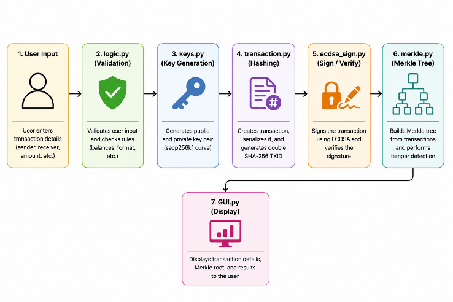
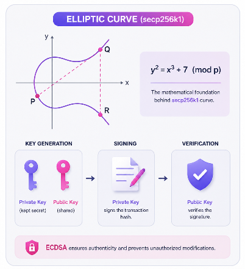
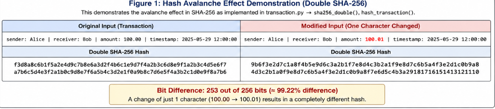
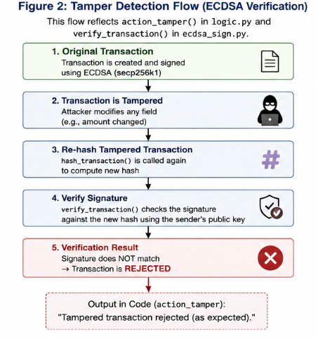
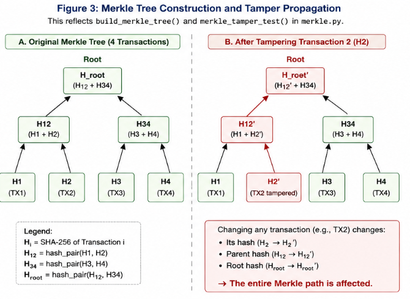
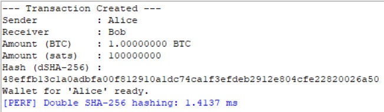
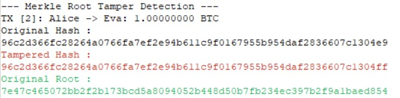
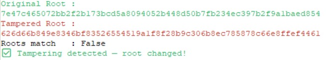

<i>Building trust through cryptography, not intermediaries.</i>

---

## 01 // Project Overview

Crypto Coin System is a Python-based desktop application designed to demonstrate the cryptographic mechanisms behind Bitcoin-style transaction security.

We developed an interactive system that supports transaction creation, cryptographic key generation, transaction hashing, digital signatures, signature verification, Merkle tree construction, and tamper detection.

The project combines applied cryptography, software development, and transaction integrity verification within a graphical user interface.

---

## 02 // Project Objectives

- Implement double SHA-256 transaction hashing.
- Generate cryptographic keys using secp256k1 ECC.
- Sign and verify transactions using ECDSA.
- Construct Merkle trees for transaction integrity.
- Identify unauthorized transaction modifications.
- Evaluate cryptographic performance.
- Develop an interactive desktop application.

---

## 03 // System Profile

<table>
<tr><th>Property</th><th>Details</th></tr>
<tr><td>Application</td><td>Crypto Coin System</td></tr>
<tr><td>Programming Language</td><td>Python</td></tr>
<tr><td>Graphical Interface</td><td>Tkinter</td></tr>
<tr><td>Hashing Algorithm</td><td>Double SHA-256</td></tr>
<tr><td>Elliptic Curve</td><td>secp256k1</td></tr>
<tr><td>Digital Signature</td><td>ECDSA</td></tr>
<tr><td>Integrity Verification</td><td>Merkle Tree</td></tr>
<tr><td>Architecture</td><td>7 Python Modules</td></tr>
</table>

---

## 04 // Technical Arsenal

---

## 05 // System Architecture

<table>
<tr><th>Module</th><th>Functionality</th></tr>
<tr><td>keys.py</td><td>Cryptographic key generation</td></tr>
<tr><td>transaction.py</td><td>Transaction creation, serialization, and hashing</td></tr>
<tr><td>ecdsa_sign.py</td><td>Digital signature generation and verification</td></tr>
<tr><td>merkle.py</td><td>Merkle tree construction and tamper detection</td></tr>
<tr><td>wallet.py</td><td>Sender wallet management</td></tr>
<tr><td>logic.py</td><td>Application logic and input validation</td></tr>
<tr><td>GUI.py</td><td>Graphical user interface</td></tr>
</table>

---

## 06 // System Workflow

<table>
<tr><td align="center">Transaction Input</td></tr>
<tr><td align="center">↓</td></tr>
<tr><td align="center">Input Validation</td></tr>
<tr><td align="center">↓</td></tr>
<tr><td align="center">secp256k1 Key Generation</td></tr>
<tr><td align="center">↓</td></tr>
<tr><td align="center">Double SHA-256 Hashing</td></tr>
<tr><td align="center">↓</td></tr>
<tr><td align="center">ECDSA Digital Signature</td></tr>
<tr><td align="center">↓</td></tr>
<tr><td align="center">Signature Verification</td></tr>
<tr><td align="center">↓</td></tr>
<tr><td align="center">Merkle Tree Construction</td></tr>
<tr><td align="center">↓</td></tr>
<tr><td align="center">Integrity Verification and Tamper Detection</td></tr>
</table>

---

## 07 // Cryptographic Mechanisms

### Double SHA-256 Hashing

Transactions are serialized and hashed twice using SHA-256 to produce a deterministic 256-bit transaction identifier.

TXID = SHA256(SHA256(serialized_transaction))

Even a small modification to the transaction produces a substantially different hash.

### secp256k1 Elliptic Curve Cryptography

The system generates a unique public and private key pair for each sender using the secp256k1 elliptic curve.

The private key is used for signing transactions, while the corresponding public key is used for signature verification.

### ECDSA Digital Signatures

ECDSA is used to authenticate signed transactions and verify their integrity.

Valid signatures confirm that the transaction corresponds to the signing key and has not been modified after signing.

### Merkle Tree

Transaction hashes are combined recursively using double SHA-256 to construct a Merkle tree.

The resulting Merkle root represents the integrity of the transaction collection.

---

## 08 // Tamper Detection

### Digital Signature Tamper Test

The system evaluates transaction integrity by modifying the receiver or transaction amount and verifying the modified transaction against its original digital signature.

The altered transaction fails signature verification in the demonstrated tests.

### Merkle Root Tamper Test

The system modifies a transaction hash and reconstructs the Merkle tree.

The original and modified Merkle roots are compared to identify changes in transaction integrity.

---

## 09 // Security Features

<table>
<tr><th>Security Property</th><th>Mechanism</th></tr>
<tr><td>Data Integrity</td><td>Double SHA-256</td></tr>
<tr><td>Authentication</td><td>ECDSA Digital Signatures</td></tr>
<tr><td>Transaction Integrity</td><td>Signature Verification</td></tr>
<tr><td>Batch Integrity</td><td>Merkle Tree</td></tr>
<tr><td>Tamper Detection</td><td>Hash and Signature Comparison</td></tr>
<tr><td>Input Validation</td><td>Transaction Data Verification</td></tr>
</table>

---

## 10 // Findings and Results

<table>
<tr><th>Feature</th><th>Test Result</th></tr>
<tr><td>Key Pair Generation</td><td>Successful</td></tr>
<tr><td>Transaction Hashing</td><td>Successful</td></tr>
<tr><td>ECDSA Signing</td><td>Successful</td></tr>
<tr><td>Original Signature Verification</td><td>Valid</td></tr>
<tr><td>Modified Transaction Verification</td><td>Rejected</td></tr>
<tr><td>Merkle Tree Construction</td><td>Successful</td></tr>
<tr><td>Merkle Root Tamper Test</td><td>Mismatch Detected</td></tr>
</table>

The prototype successfully demonstrated transaction hashing, digital signature verification, and tamper detection during the reported tests.

---

## 11 // Performance Analysis

<table>
<tr><th>Cryptographic Operation</th><th>Observed Execution Time</th></tr>
<tr><td>Double SHA-256 Hashing</td><td>0.07 - 1.5 ms</td></tr>
<tr><td>ECDSA Signing</td><td>1 - 5 ms</td></tr>
<tr><td>ECDSA Verification</td><td>3 - 7 ms</td></tr>
<tr><td>Merkle Tree (2 Leaves)</td><td>0.05 - 0.1 ms</td></tr>
</table>

Execution times were measured using Python's perf_counter() function during local testing.

Performance may vary depending on hardware, system conditions, and workload.

---

## 11.1 // Implementation and Results

### 01 - System Architecture

The system architecture illustrates the transaction workflow, from input validation to cryptographic integrity verification.

### 02 - Elliptic Curve Cryptography

The secp256k1 elliptic curve is used for cryptographic key generation, digital signing, and signature verification.

### 03 - SHA-256 Avalanche Effect

The avalanche effect demonstrates how a small modification to transaction data produces a significantly different hash.

### 04 - ECDSA Tamper Detection

The digital signature verification process detects unauthorized modifications to signed transactions.

### 05 - Merkle Tree Tamper Detection

The Merkle tree demonstrates how changes to individual transaction hashes affect the final Merkle root.

### 06 - Transaction Creation Output

The system demonstrates successful transaction creation and cryptographic processing.

### 07 - Tamper Detection Test

The system evaluates transaction integrity by testing modified transaction data.

### 08 - Merkle Root Comparison

The original and modified Merkle roots are compared to detect transaction tampering.

---

## 12 // How to Run

Requirements:

- Python 3.8 or later
- ECDSA Python Library
- Tkinter

<pre>
pip install ecdsa
python GUI.py
</pre>

All project modules should be located in the same directory.

---

## 13 // Future Improvements

- Proof-of-work mining simulation.
- Multi-block blockchain implementation.
- Multi-signature transactions.
- Compressed public key support.
- Bitcoin-style address generation.
- Peer-to-peer network simulation.

---

## 14 // Skills Demonstrated

---

## 15 // Academic Information

**University:** University of Prince Mugrin (UPM)

**College:** College of Computer and Cyber Sciences

**Department:** Cybersecurity and Forensic Computing

**Course:** FC421/FC322 - Advanced Cryptography

**Semester:** Spring 2026

**Project Type:** Collaborative Cryptography Project

---

## 16 // References

- [Bitcoin Whitepaper](https://bitcoin.org/bitcoin.pdf)
- [NIST FIPS 180-4 - Secure Hash Standard](https://nvlpubs.nist.gov/nistpubs/FIPS/NIST.FIPS.180-4.pdf)
- [NIST FIPS 186-5 - Digital Signature Standard](https://nvlpubs.nist.gov/nistpubs/FIPS/NIST.FIPS.186-5.pdf)
- [Python Hashlib Documentation](https://docs.python.org/3/library/hashlib.html)
- [Python ECDSA Library](https://github.com/tlsfuzzer/python-ecdsa)

---

## 17 // Disclaimer

This project was developed for educational and cryptographic research purposes at the University of Prince Mugrin.

It is a simplified Bitcoin-style transaction security prototype, not a complete blockchain, cryptocurrency, or production-ready financial application.

---

  

<i>Question everything. Trust the evidence.</i>

  

<b>M O O N W 4 R E</b>

